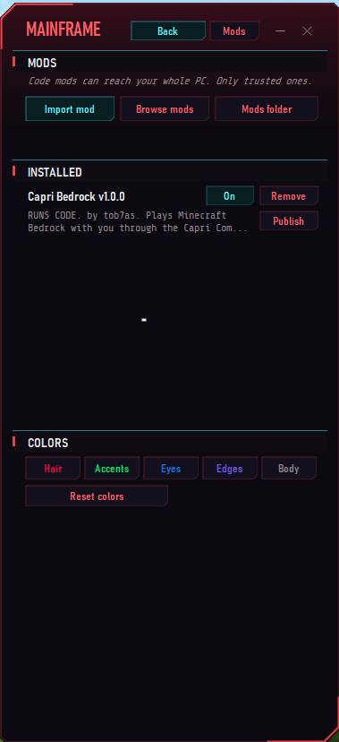
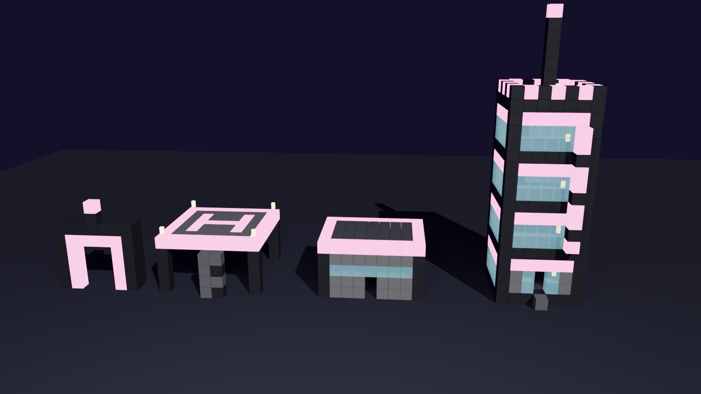

# Capri for Minecraft

<p align="center">
  <a href="https://github.com/tob7as/Minecraft-with-Capri-/releases/latest"></a>
</p>

**Capri, the neon netrunner AI, as your companion in Minecraft Bedrock.** She follows you, fights for you, mines, builds, crafts and talks. With the **Capri Bedrock mod** for [Lachy's Capri](https://github.com/lachydotmcg/capri-desktop), you can talk to her out loud and her body in the game does it.

For custom add-ons or commissions, add me on Discord: **@.tob1s**

Also check out **AdemDEV** for commissions! <https://github.com/AdemonG1tHub>

---

## ⬇️ Download

<p align="center">
  <a href="https://github.com/tob7as/Minecraft-with-Capri-/releases/download/v1.7.7/Capri_Companion_v1.7.7.mcaddon"></a>
  &nbsp;
  <a href="https://github.com/tob7as/Minecraft-with-Capri-/releases/download/v1.7.7/capri-bedrock.capri-code"></a>
  &nbsp;
  <a href="https://github.com/lachydotmcg/capri-desktop"></a>
</p>

| What | Download | |
|---|---|---|
| **Minecraft add-on** (v1.7.7) | [**Capri_Companion_v1.7.7.mcaddon**](https://github.com/tob7as/Minecraft-with-Capri-/releases/download/v1.7.7/Capri_Companion_v1.7.7.mcaddon) | Double-click it, Minecraft imports it |
| **Capri Bedrock mod** | [**capri-bedrock.capri-code**](https://github.com/tob7as/Minecraft-with-Capri-/releases/download/v1.7.7/capri-bedrock.capri-code) | Import it in Lachy's Capri (Setup, step 2) |
| **Capri** (the desktop app, by Lachy) | [**lachydotmcg/capri-desktop**](https://github.com/lachydotmcg/capri-desktop) | Get **Capri-Setup.exe** from his page |

Click a button and the download starts. The add-on works on its own: the mod and Lachy's Capri are only needed if you want to talk to her with your voice.

## 🛠️ Setup

### 1. The add-on

1. Double-click **Capri_Companion_v1.7.7.mcaddon**. Minecraft opens and imports both packs.
2. Make or edit a world. Under **Behavior Packs** and **Resource Packs**, turn on **Capri Companion**. The resource pack comes with it.
3. Join the world. You get **Capri's chip**. Use it to open her Mainframe, then press **Summon** (or type `/capri summon`).
4. `/capri help` lists everything she can do. Tap her to make her stay or follow, sneak and tap her for her job menu.

Needs Minecraft Bedrock 1.26.50 or newer. `/capri` works without cheats.

### 2. Talk to her: the mod for Lachy's Capri

1. Install **Capri** from Lachy's GitHub: **<https://github.com/lachydotmcg/capri-desktop>** (download **Capri-Setup.exe** and run it, then set her up as his page says).
2. Download **[capri-bedrock.capri-code](https://github.com/tob7as/Minecraft-with-Capri-/releases/download/v1.7.7/capri-bedrock.capri-code)** with the **Capri Bedrock Mod** button above.
3. In Capri, open the **Mainframe** and press **Mods** (in the CAPRI band).
4. Press **Import mod** and pick the `capri-bedrock.capri-code` file you downloaded.
5. It's a code mod, so Capri asks before it runs. Say **yes**. It then shows under **INSTALLED** as **Capri Bedrock**: make sure its button says **On**.

   

6. In Minecraft, turn on **cheats** for the world and type in chat:
   ```
   /connect localhost:19131
   ```
   If it won't connect, go to **Settings → General** in Minecraft and turn off **Require Encrypted Websockets**.
7. Capri says "i'm in your minecraft world now, choom!". Now just talk: "Capri, chop some wood", "Capri, build the neon tower", "Capri, kill zombies". You can also type "capri, ..." in game chat.

Code mods are Windows only for now. Port 19131 busy? Change it in `settings.txt` in the mod's `capri-bedrock-data` folder (next to Capri's mods) and use that port in `/connect`.

## ✨ What she does

- **Jobs:** chop wood, mine down for ores, farm, fight, hunt, collect blocks, craft almost anything, cook, light up caves, scan for ores, store your stuff in chests, find where you died.
- **Fights for you:** kill orders, protect mode, mantis blades, monowire, synapse burnout, energy ball, orbital laser and a real tactical nuke.
- **Cyberware for you:** Sandevistan slow-mo, optical camo, Kerenzikov, double jump, a second heart and more, installed by **Kaz the ripperdoc**, who visits your world every 10 to 15 minutes.
- **Eddies and gigs:** earn €$ from 57 gigs (kill, mine, bring and courier jobs), plus rare **Max-Tac bounties** for the Warden, the Wither and the Ender Dragon. Spend them on chrome, Capri's upgrades and new builds.
- **Builds:** a hut, house, tower, bridge, wall and more from her backpack, plus paid plans that bring their own materials: **Neon Gate**, **AV Landing Pad**, **Netrunner Safehouse** and **Neon Tower**.
- **Cyberpsychosis:** too much chrome and your screen starts to glitch. Kaz sells immunosuppressants.
- **With the mod:** she says her game lines out loud, calls out danger (creepers, swarms, low health), greets your friends when they join, and holds a grudge against whatever killed you until you take it down.

Everything, with every command, is in **[addon/README.md](addon/README.md)**.

## 🏙️ New builds




## 🎬 See her in action


Click a clip, then **View raw**, to download it with sound.

| | |
|---|---|
| [](videos/dancing.mp4)<br>**Dancing:** "drop the beat!!" | [](videos/fighting.mp4)<br>**Fighting:** she takes on mobs with you |
| [](videos/day-and-night.mp4)<br>**Day and night:** she reacts to sunrise, nightfall and sleep | [](videos/mining.mp4)<br>**Mining:** "digging down for shiny stuff now" |

## 💬 Suggestions

Got an idea for Capri, or found a bug? Add me on Discord: **@.tob1s**

## Credit

Capri is made by **Lachy**: <https://github.com/lachydotmcg/capri-desktop>. Capri's art and animations are by her artist, who prefers to stay private. The [app/](app/) folder is an older Capri X fork, shared under the original project's PolyForm Noncommercial License 1.0.0 ([app/LICENSE.md](app/LICENSE.md)).

**The add-on is not open source.** Copyright 2026 tob7as, all rights reserved: you may download it and play it, but not copy, change, re-upload or share its files. Capri's character and art in it still belong to Lachy and her artist.

Required Notice: Copyright 2026 Lachy (https://github.com/lachydotmcg)
